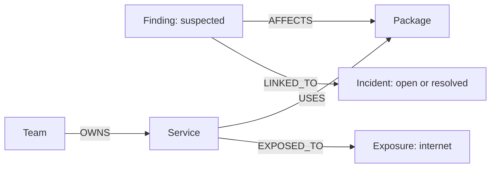

# Graph Hacks: which finding should we fix first, and why?

Ghost now has an opt-in FalkorDB triage demo. Its bounded agent executes three
parameterized Cypher reads: rank the findings, traverse the winner's service
context, then retrieve its incident links. FalkorDB calculates the scores and
orders the candidates. Ghost explains that returned order using graph witnesses.
There is no Python severity-sort fallback, cached recommendation or LLM request.

The single packaged dataset is entirely synthetic. This is a context-sensitive
triage recommendation, not proof of exploitability or a verified repair.

## Run locally

Requirements: Python 3.12+, uv, Docker Engine/Desktop with Compose v2, and an
available loopback port 6379. Run from this repository checkout:

```bash
docker compose -f examples/graph_triage/compose.yaml up -d --wait
uv sync --locked --extra graph
uv run --locked --extra graph ghost triage --load-demo
uv run --locked --extra graph ghost triage "Which finding should we fix first, and why?"
uv run --locked --extra graph ghost triage --json
```

`--load-demo` explicitly upserts the bundled sample, then answers the question.
It uses the dedicated `ghost_graph_hacks_v1` graph and never deletes other graphs.
Repeated loads merge the same nodes/edges without duplicating them; they restore
missing seed edges but do not remove additional graph edits. Normal `triage`
performs only `GRAPH.RO_QUERY` reads and does not reread the local sample for its
answer. The command works outside a Git repository; `/triage` works in Ghost's REPL.
Only the one question above is supported. Other questions fail before connecting.

The optional `graph` extra installs FalkorDB's Python client. Default Ghost
installs and existing `find`, `findings`, `brief`, `compare`, `report` and repair
flows require neither that client nor a running graph server.

Compose pins the tested **FalkorDB 4.22.1** image by manifest digest and binds
only `127.0.0.1:6379`; it adds an append-only data volume. For a port conflict,
change the host side of the Compose mapping, for example to `127.0.0.1:6380:6379`,
then pass `ghost triage --port 6380`. The client always connects to loopback.
For a separately configured local authenticated server, use
`GHOST_FALKORDB_USERNAME` and `GHOST_FALKORDB_PASSWORD`; they are never printed.
The demo Compose service uses no password and is intended for local use.
Compose starts `redis-server` directly so persistence options are honored;
the image's optional browser/startup wrapper is not needed for this feature.

```bash
# Stop; keep the demo volume.
docker compose -f examples/graph_triage/compose.yaml down
```

The graph client has a two-second connection budget, four-second socket budget,
no retry loop, and a one-second server query timeout. Missing client, unavailable
server, ordinary Redis without the graph module, missing sample, and failed
queries return exit 2 with setup guidance on stderr. JSON stdout stays empty on
failure. A successful answer returns exit 0; this is not a security pass/fail exit.

## Result and demo story

| Graph rank | Finding | Severity | Graph score | Relevant context |
| --- | --- | --- | --- | --- |
| 1 | F-002: shell command candidate | MEDIUM | **115** | Public task API, open incident INC-042, Platform Engineering owner. |
| 2 | F-003: TLS verification disabled | HIGH | 75 | Internet-facing edge gateway; no open incident recorded. |
| 3 | F-001: deserialization candidate | HIGH | 35 | Internal billing worker; no internet or incident link recorded. |

The answer shows these actual relationship paths for F-002:

```text
Finding F-002 -[AFFECTS]-> Package task-runner <-[USES]- Service public-api
Finding F-002 -[AFFECTS]-> Package task-runner <-[USES]- Service public-api -[EXPOSED_TO]-> Exposure internet
Finding F-002 -[AFFECTS]-> Package task-runner <-[USES]- Service public-api <-[OWNS]- Team platform (Platform Engineering)
Finding F-002 -[LINKED_TO]-> Incident INC-042 (open: Suspicious task execution)
```

Recorded from the running local FalkorDB demo:
[terminal capture](../examples/graph_triage/demo-terminal.png),
[plain output](../examples/graph_triage/demo-output.txt), and
[full JSON with executed Cypher](../examples/graph_triage/demo-result.json).

The demo policy is explicit and computed in Cypher:

```text
score = severity points + 40 × distinct internet-exposed services
        + 50 × distinct open incidents + 5 × distinct affected services
severity points: HIGH 30, MEDIUM 20, LOW 10, UNDEFINED 0
F-002: 20 + 40 + 50 + 5 = 115
```

Ties use public-service count, open-incident count, then finding ID. Ownership
provides an actionable team, not a score bonus. Counts use DISTINCT so repeated
paths do not inflate the score. Weights are a transparent hackathon policy, not
a calibrated security-risk probability. Missing edges mean unknown context;
they do not establish that an application is internal, safe or incident-free.

To demonstrate that FalkorDB is central, the integration test removes only the
F-002 → INC-042 relationship. Without changing the sample file or Python code,
a new answer makes **F-003 first at 75**, while F-002 falls to 65. Loading the
sample again restores F-002's incident edge and its 115-point priority.

## Graph schema



Every domain node carries `id`, `dataset=ghost-graph-hacks-v1` and
`synthetic=true`. Finding nodes reuse Ghost's ID, rule, severity, confidence,
location and suspected-state fields. Context entities have names; incidents
also have status. A `GhostTriageDemo` marker identifies the loaded schema version.
The sample contains **14 nodes including the marker, and 12 relationships**.
Zero-filled finding hashes are explicit synthetic placeholders, not scanner
evidence, and never enter Ghost's audit database or repair workflow.

The loader validates bounded entity counts, unique IDs and typed relationship
endpoints before writing. Fixed label/edge names and parameter maps prevent
sample strings from becoming Cypher syntax. One bounded MERGE query loads the
sample. New datasets, real-audit import and package/service discovery are outside
this focused increment; no private repository data is sent to FalkorDB.

## Key Cypher queries

The complete executed text is exported in `query_trace` by `ghost triage --json`
and maintained in [triage_queries.py](../core/security/triage_queries.py).
The ranking query traverses the relationships before scoring:

```cypher
MATCH (d:GhostTriageDemo {id: $dataset, version: 1, ready: true})
MATCH (f:Finding {dataset: $dataset})
OPTIONAL MATCH (f)-[:AFFECTS]->(p:Package {dataset: $dataset})
OPTIONAL MATCH (s:Service {dataset: $dataset})-[:USES]->(p)
OPTIONAL MATCH (s)-[:EXPOSED_TO]->(e:Exposure {dataset: $dataset, id: 'internet'})
WITH f, count(DISTINCT s) AS services,
     count(DISTINCT CASE WHEN e IS NOT NULL THEN s ELSE null END) AS public_services
OPTIONAL MATCH (f)-[:LINKED_TO]->(i:Incident {dataset: $dataset, status: 'open'})
WITH f, services, public_services, count(DISTINCT i) AS open_incidents
```

Its remaining clauses assign the documented points, sum them, and
`ORDER BY score DESC, public_services DESC, open_incidents DESC, finding_id ASC`.
Two follow-up queries bind `$finding` to that first returned ID. Service evidence
adds `OPTIONAL MATCH (t:Team {dataset: $dataset})-[:OWNS]->(s)` and returns
the package, service, exposure and owner IDs. Incident evidence is:

```cypher
MATCH (f:Finding {dataset: $dataset, id: $finding})-[:LINKED_TO]->(i:Incident {dataset: $dataset})
RETURN DISTINCT f.id AS finding_id, i.id AS incident_id,
                i.name AS title, i.status AS status
ORDER BY incident_id
LIMIT 20
```

The client uses `GRAPH.RO_QUERY` for all three reads. Ghost validates score
components and checks that distinct service/public-service/open-incident
witnesses match the ranking. A mismatch blocks the explanation. Reads are
bounded to 20 ranked findings, 200 service rows and 20 incident rows. They are
separate operations, not an atomic snapshot; keep the local demo graph quiet
while asking. This is not a production multi-tenant graph service.

## What is new event work, and what is reused?

Implementation began on **16 October 2026**, after Ghost baseline
`825a9a52ef111e19ba93c9d619fdbd9dbcd52f79`. The FalkorDB feature is new in this
increment; Ghost itself is a pre-existing project. This table makes that boundary
explicit for the submission rather than presenting the whole repository as new.

| Newly built for Graph Hacks | Reused from Ghost |
| --- | --- |
| Synthetic relationship dataset and validation. | `SecurityFinding` shape and suspected-state semantics. |
| FalkorDB adapter, parameterized MERGE loader and read-only graph reasoning. | CLI registration, REPL dispatch and completion. |
| Cypher ranking policy, witness queries, score explanation and query trace. | Terminal palette, literal rendering and responsive cards. |
| `ghost triage`, local Compose setup and demo documentation. | Existing Python/JS scan, brief, history, comparison and repair workflows, unchanged. |
| Graph-specific regression tests and real-server CI job. | Existing test runner, dependency lock and release checks. |

The new client, queries, data and agent orchestration are independently written
from this feature's requirements using installed public APIs. No third-party
implementation, sample, scanner rule or template was copied. See
[dependency provenance](source-provenance.md) for separately installed client and
server licenses. Ghost does not bundle or relabel FalkorDB's server as MIT.

## Validate the demo

```bash
uv sync --locked --extra dev --extra graph
GHOST_FALKORDB_TEST_PORT=6379 uv run --locked --extra dev --extra graph \
  python -m pytest -q tests/test_graph_triage.py tests/test_graph_triage_integration.py
```

Real tests create unique disposable graphs and delete only those graphs. They
cover graph-derived ranking, a recommendation changing after a relationship
edit, duplicate-path accounting, idempotent loading, dataset isolation, read-only
answers and execution outside a Ghost repository. Without the opt-in environment
variable, integration tests skip; missing/unavailable FalkorDB is never reported
as a successful real-server test. The dedicated GitHub workflow starts the pinned
server and runs these checks on relevant changes.

Validated on Linux on 16 October 2026: **1,238 tests passed** with no failures,
errors or skips, including all six real FalkorDB integration cases. The final
Compose configuration then passed all 24 graph-specific checks, reported
`appendonly=yes` in the mounted data directory, and returned the identical
read-only answer after a server restart without reloading the sample. The built
wheel also ran the real demo from outside the checkout using its packaged JSON.
Website type/build checks and browser checks at 320, 390, 768 and 1440 pixels
passed, including the new phase and documentation without JavaScript.
